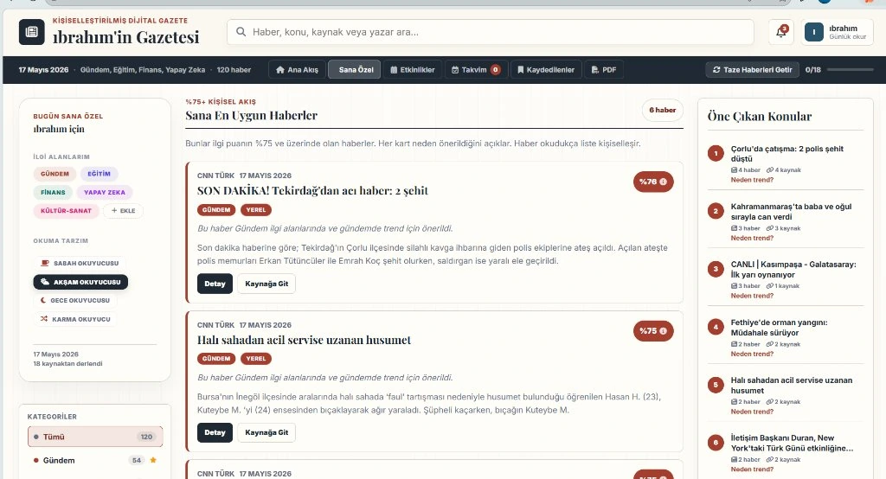

# 📰 Smart Personnel Newspaper — Kişiselleştirilmiş Dijital Gazete

  
  
  
  
  

An AI-assisted personalized news aggregation and digital newspaper platform that curates daily editions based on reader interest profiles, reading habits, and multi-source NLP categorization.

---

## ✨ Key Capabilities

- **Multi-Source News Ingestion & Deduplication:** Automated RSS/crawler pipelines with source citation tracking and duplicate cluster detection.
- **NLP Categorization & Explainable Recommendations:** Multi-label topic classification (`Gündem`, `Finans`, `Yapay Zekâ`, `Eğitim`, `Kültür-Sanat`) with match-score explanations (e.g., `%76 Sana Özel`).
- **Reader Persona & Pacing Modes:** Tailored daily feeds for morning, evening, night, or mixed reading styles.
- **Trending Story Clustering & Print-Ready PDF Export:** Groups related coverage across sources and exports A4/tabloid digital newspaper editions.

---

## 🏗️ System Architecture

1. **Ingestion Layer:** Scheduled crawlers & RSS connectors normalize articles and remove near-duplicates.
2. **NLP & Ranking Engine:** Computes semantic similarity, category weights, and user-interest match scores.
3. **Web Application & PDF Edition Service:** Delivers the interactive newspaper dashboard, saved bookmarks, calendar events, and downloadable PDF editions.

---

## 👤 Author

**İbrahim Türkel** — [ibrahimturkel.com.tr](https://ibrahimturkel.com.tr) · [GitHub](https://github.com/turkelibrahim) · [LinkedIn](https://www.linkedin.com/in/ibrahim-t%C3%BCrkel-065283261/)
